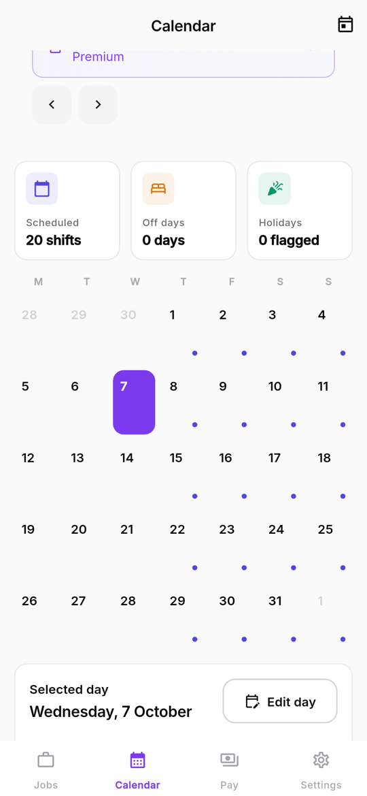
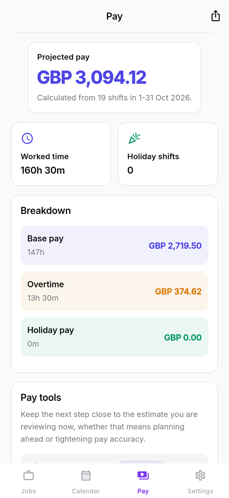
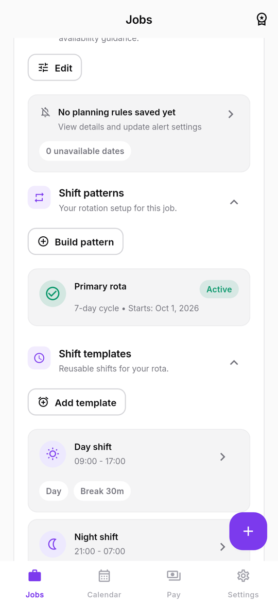

# ShiftMate Pay

    

An offline-first app for shift workers that answers three questions: *When am I working? What should I get paid? Did my payslip get it right?*

It combines a rotating shift calendar, a pay estimator that understands real-world pay rules, and a payslip checker that flags discrepancies, all stored on the device with no account.

## Screenshots

| Rota calendar | Pay estimate | Rota setup |
|:---:|:---:|:---:|
|  |  |  |

## Features

**Schedule**
- Rotating shift pattern builder (e.g. 4-on/4-off, Earlies/Lates/Nights)
- One-off shift edits, notes per shift, weekly and monthly calendar views
- CSV rota import with a preview before anything is saved
- Calendar export (`.ics`)

**Pay**
- Hourly rate per job with advanced rules: overtime tiers, night and weekend differentials, allowances, unpaid-break overrides
- Weekly and monthly pay estimates
- 30 / 60 / 90-day income forecast

**Verification**
- Enter a payslip and compare it with the expected pay for that period
- Line-by-line discrepancy review so underpayments are easy to spot and raise

**Planning and reminders**
- Availability, rest-period and overtime-limit rules with conflict alerts
- Local notifications before shifts and for sleep routines

**Data**
- JSON backup and restore, PDF summaries
- Premium features gated through Google Play Billing

## Tech stack

| Area | Technology |
|---|---|
| UI | Flutter, Material 3 |
| State | Riverpod |
| Navigation | GoRouter |
| Persistence | Drift (SQLite) |
| Models | Freezed, json_serializable |
| Notifications | flutter_local_notifications, timezone |
| Billing | in_app_purchase (Google Play) |
| Documents | pdf |

## Architecture

Clean architecture with feature-first presentation:

```
lib/
├── app/        bootstrap, routing, theme
├── core/       money and time primitives, shared services
├── domain/     entities, repository contracts, pay and schedule engines, use cases
├── data/       Drift database, mappers, repository implementations
└── features/   calendar, patterns, jobs, pay, import, export, planning, reminders, premium, settings
```

Money is handled with integer minor units and pay calculations live in the domain layer, so the rules engine is plain Dart and fully unit-testable.

Design notes and specs:
- [Architecture](docs/architecture.md) and [tech stack decision record](docs/adr/001-tech-stack.md)
- [Schedule engine](docs/schedule-engine-spec.md), [pay rules](docs/pay-rules-spec.md), [advanced pay rules](docs/advanced-pay-rules-spec.md)
- [Pay verification](docs/pay-verification-spec.md), [forecasting](docs/forecasting-spec.md), [rota import](docs/import-spec.md)
- [Testing strategy](docs/testing-strategy.md)

## Getting started

```bash
flutter pub get
dart run build_runner build --delete-conflicting-outputs   # Drift and Freezed code generation
flutter run
```

### Release signing

Release builds read signing details from `android/keystore.properties` (git-ignored). Copy `android/keystore.properties.template`, fill it in, and point it at your own keystore.

## Testing

```bash
flutter test
flutter analyze
```

_Developed March–April 2026. Imported from a private repository; the commit history was left out because it contained credentials._

## License

MIT. See [LICENSE](LICENSE).
